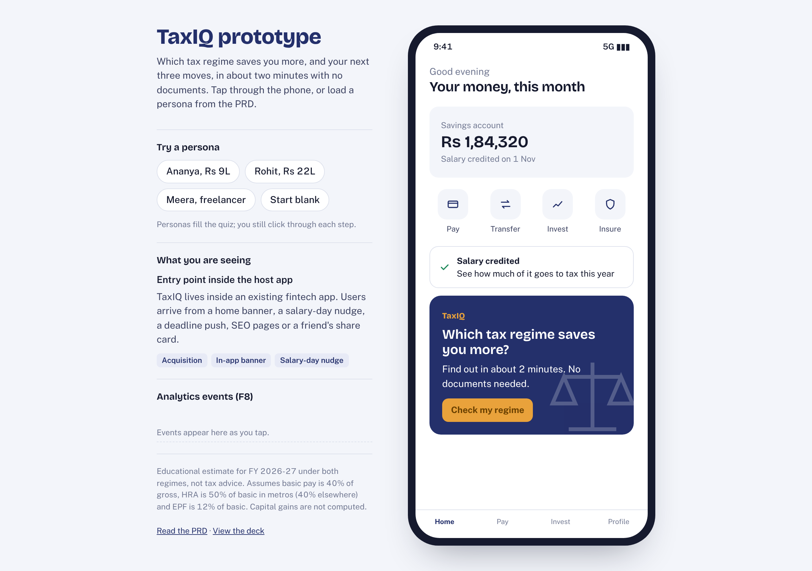
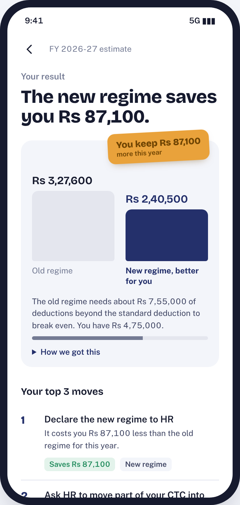
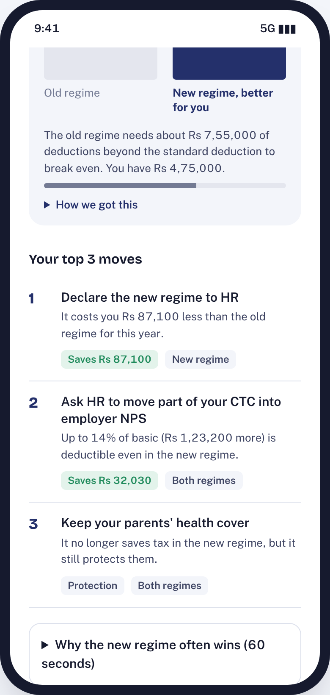
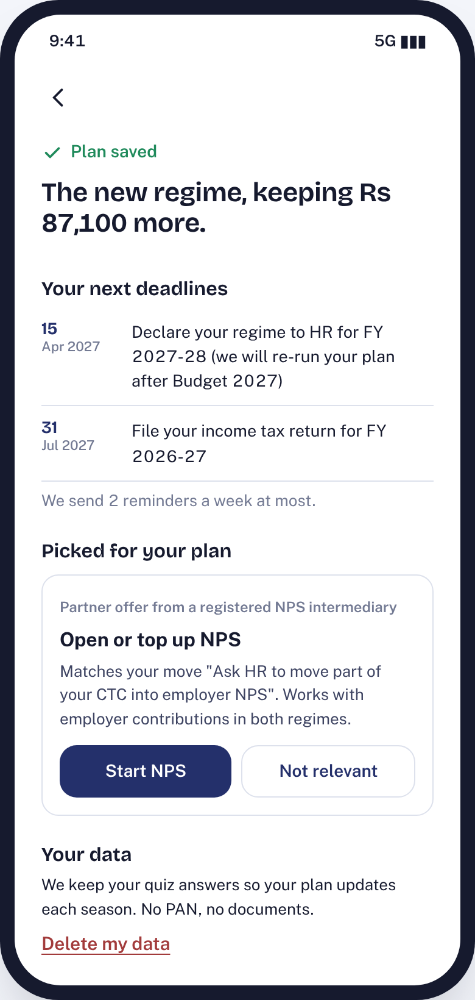

# TaxIQ: The Product Sprints capstone

**Your better tax regime and your next three moves, in 2 minutes and with no documents.**

TaxIQ is a product strategy, PRD, deck and clickable prototype for a tax-planning module inside an Indian fintech app. It was built for the capstone of The Product Sprints (Product Club, IIT Kanpur): design a module that drives user acquisition, engagement, data collection and monetisation.



## What is in this repo

| Deliverable | Files | What it covers |
| --- | --- | --- |
| Product Requirements Document | [prd/TaxIQ-PRD.md](prd/TaxIQ-PRD.md), [PDF](prd/TaxIQ-PRD.pdf) | Problem and 5 Whys RCA, personas, competitive analysis, goals, features (MoSCoW), KPIs and forecast, RICE and roadmap, constraints and risks |
| Product deck (10 slides) | [deck/TaxIQ-Deck.pptx](deck/TaxIQ-Deck.pptx), [PDF](deck/TaxIQ-Deck.pdf) | Problem + RCA, focus market, positioning, MVP, prototype flow, prioritisation, metrics and forecast, go-to-market |
| Clickable HTML prototype | [prototype/index.html](prototype/index.html) | Entry point, 4-step quiz, Old vs New comparator, top 3 moves, consent, saved plan, share card, live analytics event log |
| Tax engine and tests | [prototype/tax-engine.js](prototype/tax-engine.js), [tests/](tests/tax-engine.test.mjs) | FY 2026-27 rules for both regimes, checked against published worked examples |

## Try the prototype

Open `prototype/index.html` in a browser; it has no build step and works offline. Use the persona buttons (Ananya, Rohit, Meera) to pre-fill the quiz, then click through. The side panel shows which PRD requirement each screen demonstrates and every analytics event as it fires.

To host it, turn on GitHub Pages for this repo (Settings → Pages → Deploy from branch `main`, folder `/`). The prototype is then at `https://pruthav23.github.io/taxiq-the-product-sprints/prototype/`.

| Result | Top 3 moves | Consent | Saved plan |
| --- | --- | --- | --- |
|  |  |  |  |

## How the project maps to the resume entry

| Resume line | Where to find it |
| --- | --- |
| End-to-end PM strategy and PRD for a fintech tax-planning module | [PRD](prd/TaxIQ-PRD.md), [deck](deck/TaxIQ-Deck.pdf) |
| RCA (5 Whys) and competitive analysis found a personalisation-speed gap as the core differentiator | PRD sections 1 and 3; deck slides 2 and 4 |
| MVP prioritised with RICE and MoSCoW into a 3-phase roadmap across the AARRR funnel | PRD sections 5 and 7; deck slides 5 and 8 |
| 4-step quiz with an Old vs New tax regime comparator; clickable HTML prototype | [prototype/](prototype/index.html); deck slides 6 and 7 |
| 150K Season-1 activations; 12% to 3% cross-sell funnel; about 2,700 monetised conversions | PRD section 6; deck slide 9 |

The forecast: 1.5M landing visitors → 300K quiz starts (20%) → **150K activations** (50%) → 90K consent and see offers (60%) → 10,800 click (**12%**) → **2,700 convert** (25% of clicks, **3%** of offer viewers).

## Run the tests

```bash
node --test tests/*.test.mjs
```

13 tests cover both regimes, the Rs 12 lakh rebate and its marginal relief, senior-citizen limits, surcharge relief, break-even deductions and the PRD's Rohit example (old Rs 3,27,600, new Rs 2,40,500, saving Rs 87,100). Expected values come from published FY 2026-27 worked examples, each re-derived by hand.

## Assumptions and limits

- Tax rules are for FY 2026-27, resident individuals. Budget 2026 left slabs, the standard deduction and the 87A rebate unchanged.
- The prototype assumes basic pay is 40% of gross, HRA received is 50% of basic in metros (40% elsewhere) and EPF is 12% of basic.
- Capital gains, F&O, crypto and foreign income are not computed; the quiz routes those users to assisted filing.
- Funnel rates, team size and revenue per conversion are planning assumptions, not sourced figures.
- This is an educational project, not tax advice.

## Repository structure

```
prd/          PRD in Markdown and PDF
deck/         Product deck in PowerPoint and PDF
prototype/    Clickable HTML prototype, tax engine and bundled fonts
tests/        Tax-engine tests (Node's built-in test runner)
assets/       Prototype screenshots and deck images used by the PRD and this README
```

Fonts: Bricolage Grotesque and Public Sans, bundled under the SIL Open Font License (see `prototype/fonts/`).
