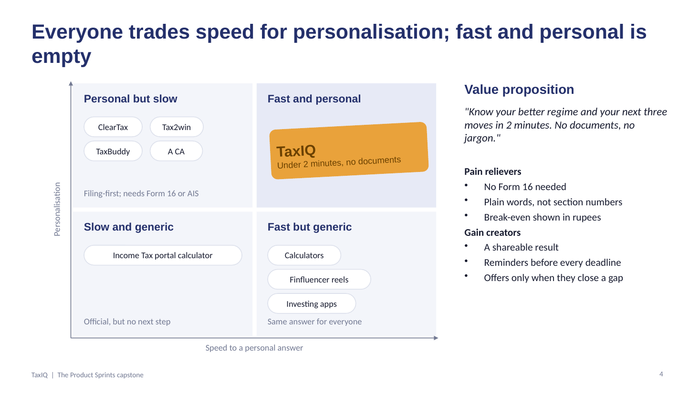
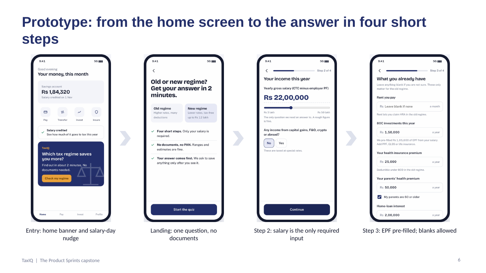
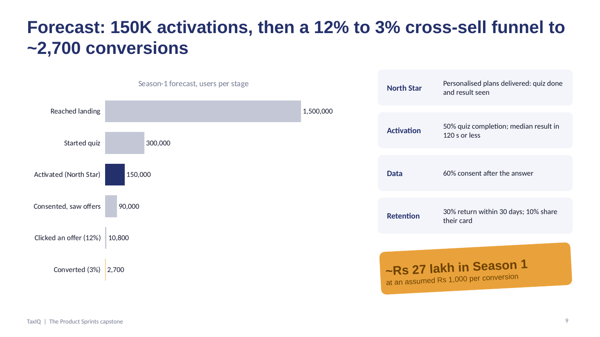
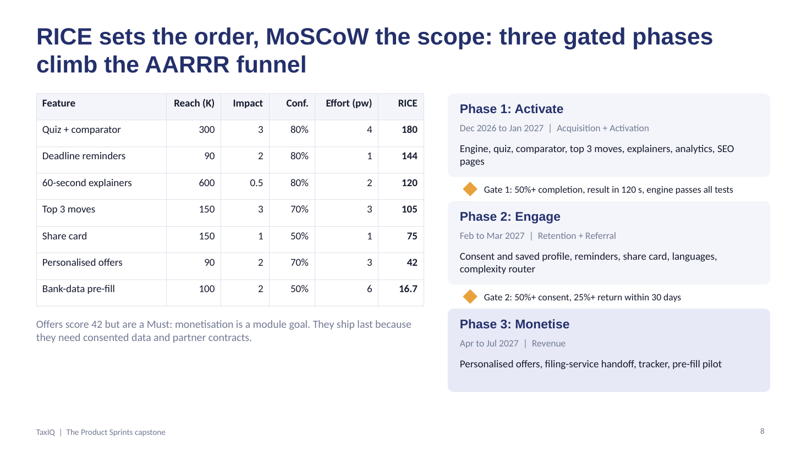

# TaxIQ: Product Requirements Document

The Product Sprints capstone, Product Club, IIT Kanpur. Updated 3 Nov 2026.

## At a glance

TaxIQ turns tax planning into a 2-minute, 4-step quiz that tells a salaried Indian which tax regime saves them more and the next three moves to make. It closes the personalisation-speed gap between fast-but-generic calculators and personalised-but-slow filing flows, and is forecast to deliver 150K Season-1 activations and about 2,700 monetised conversions.

| Item | Detail |
| --- | --- |
| Product | TaxIQ, the Tax Planning module inside the app |
| Season 1 | Dec 2026 to Jul 2027 (FY 2026-27: proof submission, 31 Mar investment deadline, 31 Jul filing) |
| Primary users | Salaried taxpayers aged 22 to 45 earning Rs 6 to 30 lakh a year |
| North Star | Personalised tax plans delivered (quiz completed and Old vs New result viewed) |
| Core differentiator | A personal, actionable answer in under 2 minutes, with no documents |
| Tax rules in engine | FY 2026-27; Budget 2026 left slabs, standard deduction and rebate unchanged |
| Prototype | [prototype/index.html](../prototype/index.html), engine tested in [tests/](../tests/tax-engine.test.mjs) |

## 1. Problem statement and root cause

Users come to the module with one question, "which regime, and do I need to invest more?", and leave before they get a personal answer. That single gap blocks all four goals of the module.

**Brief recap.** The app has launched a Tax Planning module with four goals: acquire users interested in tax help, engage them with easy tax education, collect data on income, deductions and investments, and monetise later through health/life insurance, tax-saving products and tax-filing services. As PM, the strategy must cover user acquisition, engagement hooks, low-friction data collection, KPIs, and a prototype of the full flow from entry to recommendations.

**Problem hypothesis.** Today's options are either fast but generic (calculators, blogs, finfluencer reels) or personalised but slow (filing flows that need Form 16 and AIS). With no quick personal answer there is no trust moment, so users share no data and never see an offer that fits them.

**Why now.** The choice is both harder and higher-stakes than before:

- The new regime is the default and makes taxable income up to Rs 12 lakh tax-free through the Section 87A rebate; a salaried person pays nothing up to about Rs 12.75 lakh ([slabs](https://indianpaycalculator.in/income-tax-slabs)).
- The old regime still rewards large deductions, so the answer depends on a break-even deduction level that changes with income ([break-even analysis](https://www.basunivesh.com/new-tax-regime-vs-old-regime-who-wins-in-fy-2026-27/)).
- About 72% of filers (5.27 crore of 7.28 crore returns for AY 2024-25) already chose the new regime ([Business Today](https://www.businesstoday.in/amp/personal-finance/tax/story/itr-2024-over-728-crore-tax-returns-filed-till-july-31-527-crore-opted-for-new-tax-regime-439896-2024-08-02)). The 28% on the old regime, and the many who never checked, are the people who need an answer.
- The Income-tax Act, 2025 replaced the 1961 Act from 1 Apr 2026 and renumbered sections, so familiar names like "80C" now confuse as much as they help.

**Root cause analysis (5 Whys)**

1. Why do users leave the module without a plan? They never reach a result that feels like it is about them.
2. Why not? Getting one takes many inputs (salary breakup, HRA, 80C, 80D, home loan) full of jargon.
3. Why so many inputs? Existing tools mirror the ITR form instead of the decision the user is making.
4. Why does that hurt more now? The right regime depends on a break-even deduction level users cannot work out in their head.
5. Why does it matter to the business? Without a fast personal answer there is no trust, so no consented data and no basis for a relevant offer.

**Root cause: a personalisation-speed gap.** No tool gives a personal, actionable tax answer in under 2 minutes without documents. Closing that gap is TaxIQ's core differentiator.

## 2. Target audience and personas

Season 1 targets salaried taxpayers aged 22 to 45 earning Rs 6 to 30 lakh. They face the regime choice every April and the proof deadline every January, and they can be served well without documents. Of the 7.28 crore returns for AY 2024-25, 3.34 crore were ITR-1, the simple salaried return. Freelancers follow in Phase 3.

| Persona | Profile | Needs | Behaviour today | Job to be done |
| --- | --- | --- | --- | --- |
| Ananya, the first-salary fresher | 24, Bengaluru, software engineer, Rs 9 lakh CTC, first job | Which regime to declare to HR; whether she needs to invest at all | Asks colleagues, watches finfluencer reels, keeps the default | When HR asks for my regime declaration, I want a clear answer for my salary, so I can submit without second-guessing. |
| Rohit, the deduction-heavy planner | 34, Pune, product manager, Rs 22 lakh, home loan, pays parents' health cover | Whether the old regime still wins; what to top up before 31 Mar, and where | Spreadsheets and a CA friend; buys ELSS in a March rush | When the March deadline nears, I want to know exactly what to top up, so I don't overpay tax or lock money into the wrong product. |
| Meera, the freelancer (Phase 3) | 29, Jaipur, freelance designer, Rs 14 lakh, presumptive income | Regime choice, advance-tax dates, filing help | Pays a local CA once a year; misses advance-tax dates | When a quarter ends, I want to know what tax I owe, so I avoid interest and filing stress. |

**Anti-persona.** Traders and high earners with capital gains, F&O, crypto or foreign income, and business owners needing audits. They need a CA, not a 2-minute quiz, so TaxIQ flags their complexity and routes them to assisted filing instead of giving an answer it cannot stand behind.

## 3. Competitive analysis

Every alternative trades speed against personalisation: filing platforms are personal but slow, calculators and content are fast but generic. Nobody gives a personal answer in under 2 minutes, which is the gap TaxIQ is built to own.

| Alternative | Strength | Gap for our user | Time to a personal answer (est.) |
| --- | --- | --- | --- |
| [ClearTax](https://cleartax.in/s/best-itr-filing-platforms-india) | DIY and expert filing; personalised 80C/80D tips; filing through app or WhatsApp | Planning lives inside the filing flow, which starts from Form 16 | 10 to 20 min |
| [Tax2win](https://cleartax.in/s/cleartax-vs-tax2win-comparison) | Low-cost filing, auto regime selection, tax-saving nudges, post-filing notice help | Same form-first flow; planning is basic | 10 to 20 min |
| [TaxBuddy](https://www.taxbuddy.com/blog/taxbuddy-vs-cleartax-vs-tax2win-which-platform-is-better-for-itr-filing) | Expert-assisted filing with AI-driven planning advice | Paid and expert-led; not a quick self-serve check | Hours to days |
| Income Tax portal calculator | Official and free | Form-like inputs; no recommendation or next step | 5 to 10 min |
| Investing apps (ELSS, NPS sections) | One-tap purchase of tax-saving products | Product-first with no regime answer, so they can sell 80C products to new-regime users who gain nothing | Not personal |
| Finfluencer reels and blogs | Free, relatable, fast | Generic and often out of date | Under 1 min, not personal |
| **TaxIQ** | 4-step quiz, Old vs New comparator, top 3 moves | Must earn trust as a new entrant | Under 2 min |

Times are team estimates, to be verified with timed walkthroughs during discovery.

**Value proposition: "Know your better regime and your next three moves in 2 minutes. No documents, no jargon."**

- **Pain relievers:** no Form 16 needed; plain-language labels instead of section numbers; the break-even shown in rupees.
- **Gain creators:** a shareable result; reminders before every deadline; offers shown only when they save tax or close a protection gap.

## 4. Goals and objectives

TaxIQ succeeds in Season 1 if 150K users get a personalised tax plan and about 2,700 of them buy a product that fits it.

**North Star metric: personalised tax plans delivered.** The count of users who finish the quiz and see their Old vs New result. It measures the user's job (a clear answer) and gates every later business outcome: no plan, no consent, no relevant offer.

| Module goal | AARRR stage | Measurable outcome | Season-1 target |
| --- | --- | --- | --- |
| Acquire tax-curious users | Acquisition | Unique users reaching the TaxIQ landing screen | 1.5M |
| Acquire tax-curious users | Activation | Quiz starts, completion rate, median time to result | 300K starts; 50% complete = 150K activations; 120 s or less |
| Collect user data | Activation | Activated users who consent to save their profile and see personalised offers | 60% (90K) |
| Engage with easy content | Retention | Activated users who return within 30 days | 30% |
| Engage with easy content | Referral | Activated users who share their regime card | 10% |
| Monetise via cross-sell | Revenue | Offer click-through, then purchase conversion of offer viewers | 12% CTR; 3% conversion = ~2,700 |

**Non-goals for Season 1:** full ITR filing inside the module (routed to a partner), advice on individual securities, and capital-gains, F&O or crypto computation.

## 5. Features and requirements

The MVP is a 4-step quiz that ends in an Old vs New regime comparator and three rupee-valued moves, with consent asked only after the user has their answer.

Flow: entry point (home banner, salary-day nudge, deadline push, SEO page or share link) → landing → 4-step quiz → result (Old vs New tax and saving, break-even in rupees, top 3 moves) → consent to save? → **yes:** saved profile with deadline reminders and personalised offers; **no:** session-only plan with share card and explainers, asked again next visit.

**The 4-step quiz**

| Step | We ask | Why it matters | Smart default |
| --- | --- | --- | --- |
| 1. About you | Salaried or self-employed; age band | Removes the standard deduction for the self-employed; sets senior-citizen limits | Salaried, under 60 |
| 2. Income | Annual gross salary on a slider; any capital gains, F&O, crypto or foreign income | Core tax computation; complex income triggers routing to assisted filing | Slider starts at Rs 10 lakh |
| 3. What you already have | Rent paid (and metro or not); 80C so far; health cover for self and parents; home-loan interest; own NPS | Old-regime deductions; the gaps reveal tax and protection needs | EPF estimated at 12% of basic, with basic assumed at 40% of gross |
| 4. What matters to you | Save tax, grow wealth, protect family, or file stress-free; how you file today | Ranks the top 3 moves and, later, the offers | None |

**Worked example, Rohit (Rs 22 lakh salary).** He claims Rs 4.75 lakh beyond the standard deduction: 80C Rs 1.5 lakh, home-loan interest Rs 2 lakh, health cover Rs 75,000 (self plus senior parents) and NPS Rs 50,000. The comparator shows:

| | Old regime | New regime |
| --- | --- | --- |
| Taxable income | Rs 16,75,000 | Rs 21,25,000 |
| Tax with 4% cess | Rs 3,27,600 | Rs 2,40,500 |

The new regime saves him Rs 87,100. The old regime would need about Rs 7.55 lakh of deductions beyond the standard deduction to break even. His top 3 moves: (1) declare the new regime to HR, saving Rs 87,100; (2) ask HR to route part of his CTC to employer NPS, which still counts in the new regime up to 14% of basic, worth about Rs 32,030 more; (3) keep his parents' health cover for protection, even though it no longer saves tax.

**Requirements (MoSCoW for Season 1)**

| ID | Requirement | Priority | Acceptance criteria |
| --- | --- | --- | --- |
| F1 | 4-step quiz | Must | 12 inputs or fewer; only salary mandatory; progress bar; blank allowed on every optional field; median completion 120 s or less with 8 test users |
| F2 | Tax engine for FY 2026-27 | Must | Both regimes: slabs, standard deduction (Rs 75,000 new, Rs 50,000 old), 87A rebate with marginal relief, surcharge, 4% cess, senior-citizen limits; rules stored as config per tax year; 100% match on 50 CA-verified test profiles |
| F3 | Old vs New comparator | Must | Tax under each regime, savings, recommended regime, break-even deduction in rupees, one-line reason |
| F4 | Top 3 moves | Must | Each move shows rupee impact, why it fits, and whether it works in the user's regime; labelled educational; no product named before consent |
| F5 | Consent and profile save | Must | DPDP-compliant notice; separate opt-ins for saving, reminders and offers; delete in one tap |
| F6 | Deadline reminders | Must | Proof submission (Jan), 31 Mar investment deadline, advance-tax dates (15 Jun, Sep, Dec, Mar), 31 Jul filing; opt-in; 2 pushes a week at most |
| F7 | Personalised offers | Must | Consenting users only; one offer per screen at most; tied to a gap found in F4 (health cover, term cover, NPS, filing service); labelled as a partner offer |
| F8 | Funnel analytics | Must | Events on every step, skipped field, result view, offer view, click and purchase |
| F9 | Shareable regime card | Should | Shows recommended regime and savings band, never income; deep link back to the quiz |
| F10 | 60-second explainers | Should | 120 words or fewer, linked from the result; CA-reviewed after every Budget |
| F11 | Hindi and two regional languages | Should | Full quiz and result translated; language taken from app setting |
| F12 | Complexity router | Should | Capital gains, F&O, crypto or foreign income route to assisted filing |
| F13 | Tax-saving tracker | Could | Progress toward each deduction limit, updated as the user logs investments |
| F14 | Pre-fill from bank data (Account Aggregator) | Could | With consent, salary and premiums pre-filled; user confirms every value |
| F15 | Form 16 or AIS upload | Could | Parsed fields shown for confirmation before use |
| F16 | Ask-a-CA chat | Could | Partner-led; reply within 24 h |
| W1 | Full ITR filing inside TaxIQ | Won't | Routed to a partner filing service |
| W2 | Capital-gains, F&O and crypto computation | Won't | Covered by F12 routing |

**Engagement hooks (Hook model)**

- **Trigger:** salary-day nudge, deadline reminders, a Budget-day "what changed for you" push.
- **Action:** one tap reopens the saved plan.
- **Variable reward:** "you can still save Rs X", a newly unlocked move, progress toward a deduction limit.
- **Investment:** each extra detail sharpens the plan and raises its confidence badge.
- **Content:** a personal tax calendar, 60-second explainers, and a monthly "tax pulse".

**Data collection without friction**

- Give before you get: the result comes before any sign-up or consent.
- Ranges and smart defaults instead of exact figures; blanks are always allowed.
- No PAN, Form 16 or documents in Season 1.
- A "why we ask" line on every field; consent per purpose; delete anytime.
- Progressive profiling: one more question per return visit, and only when it changes the answer.

## 6. Success metrics and impact forecast

The forecast runs 1.5M landing visitors to 150K activations and, through a 12% offer click-through and 3% purchase conversion, to about 2,700 monetised conversions.

| Stage | Users | Rate from previous stage |
| --- | --- | --- |
| Reached landing | 1,500,000 | |
| Started quiz | 300,000 | 20% |
| Activated (quiz done, result seen) | 150,000 | 50% |
| Consented, saw offers | 90,000 | 60% |
| Clicked an offer | 10,800 | 12% |
| Converted | 2,700 | 25% of clicks, 3% of offer viewers |

The 12% to 3% cross-sell funnel applies only to the 60% of activated users who consent. At an assumed blended Rs 1,000 per conversion (filing fees, insurance commission, NPS), Season 1 earns about Rs 27 lakh at near-zero acquisition cost, because most traffic is in-app. Sensitivity: an 8% click-through cuts conversions to 1,800; 50% consent cuts them to 2,250.

| Stage | KPI | Definition | Guardrail |
| --- | --- | --- | --- |
| Acquisition | Landing reach; entry click-through by channel | Unique landing visitors; landing visits divided by users shown an entry point | Push opt-out under 1% per campaign |
| Activation | Quiz completion; median time to result; North Star | Completions divided by starts; seconds from step 1 to result | No single quiz step loses more than 20% |
| Data | Consent rate; profile depth | Consenting users divided by activated; fields filled per saved profile | Consent withdrawals under 5% |
| Retention | 30-day return; reminder open rate | Activated users with a return visit within 30 days | Uninstalls traced to TaxIQ pushes |
| Referral | Share rate; K-factor | Shares divided by activated; new activations from shared links divided by activated | None |
| Revenue | Offer click-through; conversion; revenue per activated user | Clicks divided by offer viewers; purchases divided by offer viewers | "Not relevant" taps under 2%; 30-day policy cancellations |
| Quality | Tax-engine error reports | Reports of a wrong figure per 10K results | Under 1 per 10K |

## 7. Prioritisation and plan

RICE ranks the quiz and comparator first (score 180), and the roadmap ships in three gated phases that climb the AARRR funnel from activation to revenue.

| Feature | Reach (K users per season) | Impact (0.25 to 3) | Confidence | Effort (person-weeks) | RICE score |
| --- | --- | --- | --- | --- | --- |
| 4-step quiz and Old vs New comparator | 300 | 3 | 80% | 4 | 180 |
| Deadline reminders | 90 | 2 | 80% | 1 | 144 |
| 60-second explainers | 600 | 0.5 | 80% | 2 | 120 |
| Top 3 moves | 150 | 3 | 70% | 3 | 105 |
| Shareable regime card | 150 | 1 | 50% | 1 | 75 |
| Personalised offers | 90 | 2 | 70% | 3 | 42 |
| Bank-data pre-fill (Account Aggregator) | 100 | 2 | 50% | 6 | 16.7 |
| Tax-saving tracker | 60 | 1 | 60% | 3 | 12 |
| Form 16 or AIS upload | 40 | 2 | 50% | 8 | 5 |
| Ask-a-CA chat | 15 | 2 | 50% | 6 | 2.5 |

RICE = Reach × Impact × Confidence ÷ Effort. RICE sets the order; MoSCoW (section 5) sets the scope. Personalised offers score only 42 but are a Must, because monetisation is a module goal; they ship last because they need consented data and partner contracts first.

| Phase | Dates | AARRR stages | Ships | Gate to the next phase |
| --- | --- | --- | --- | --- |
| 1. Activate | Dec 2026 to Jan 2027 | Acquisition, Activation | Tax engine, quiz, comparator, top 3 moves, explainers, analytics, landing and SEO pages | 50%+ quiz completion; median result in 120 s or less; engine passes all test profiles |
| 2. Engage | Feb to Mar 2027 | Retention, Referral | Consent and saved profile, reminders, share card, languages, complexity router | 50%+ consent; 25%+ return within 30 days |
| 3. Monetise | Apr to Jul 2027 | Revenue | Personalised offers, filing-service handoff, tax-saving tracker, bank-data pre-fill pilot | Season review |

Each gate is a go/no-go: if Gate 1 misses, Phase 2 is spent fixing the quiz instead of adding reminders.

**How users find TaxIQ (acquisition, from Phase 1)**

- **In-app (product-led):** home banner in proof season (Jan) and declaration season (Apr); a salary-day nudge; entry points inside investing and insurance flows.
- **Content-led SEO:** "old vs new regime calculator FY 2026-27" pages that open straight into the quiz.
- **Creators and communities:** two or three finfluencer collaborations built around the comparator; college and alumni groups for first-jobbers.
- **Product-led loop:** the share card brings friends into the quiz.
- **B2B2C pilot:** HR partners link TaxIQ in their regime-declaration emails.

## 8. Constraints, assumptions and risks

The biggest constraints are regulatory (what counts as advice, who may sell insurance, how consent works) and a hard calendar: Phase 1 must be live before January proof season.

**Constraints**

| Type | Constraint | Implication for TaxIQ |
| --- | --- | --- |
| Regulatory | Personalised investment advice needs SEBI investment-adviser registration; insurance can only be sold through an IRDAI-registered intermediary | Moves are framed as tax education and product categories; offers come from licensed partners and are labelled as such |
| Privacy | Digital Personal Data Protection Act, 2023 | Purpose-specific consent, data minimisation, one-tap deletion; no PAN or documents in Season 1 |
| Tax law | Income-tax Act, 2025 in force from 1 Apr 2026 with renumbered sections; Budget 2027 may change slabs | Rules held as versioned config per tax year; plain-language labels with old section names as aliases |
| Time | Phase 1 has about 6 weeks before January proof season | Strict MVP scope (F1 to F8); everything else waits for Phase 2 or 3 |
| Team and budget | 1 PM, 1 designer, 3 engineers, 1 analyst, a part-time CA; no paid acquisition in Season 1 | Reuse the app's existing notifications, analytics and consent stack; growth through in-app, SEO and creators |
| Tech | No Form 16 parsing or Account Aggregator link at launch | Self-reported inputs with smart defaults; pre-fill piloted in Phase 3 |

**Assumptions to validate**

- The host app reaches enough salaried users for 1.5M of them to see TaxIQ in Season 1 (roughly 5M monthly active users, 30% exposed).
- 20% of landing visitors start the quiz and 50% of starters finish; to be checked with an A/B test of the landing copy.
- 60% of activated users consent once they have seen a useful answer.
- Offer click-through of 12% and 25% purchase among clickers, based on intent created by a personal gap; to be checked in Phase 3.
- Blended revenue of Rs 1,000 per conversion across filing fees, insurance commission and NPS.

**Risks and mitigations**

| Risk | Likelihood | Mitigation |
| --- | --- | --- |
| Wrong tax figure damages trust | Medium | 50-profile CA-verified test suite, release review by a CA, "report a wrong number" link, clear disclaimer |
| Users see offers as pushy | Medium | One offer per screen, only tied to a gap the user saw, "not relevant" button that tunes later offers |
| Most users are already on the new regime, so few deduction products fit | High | Shift moves to protection (health, term), employer NPS and the filing service, which suit both regimes |
| Seasonality: traffic collapses outside Jan to Mar and Jul | High | Advance-tax and Budget-day hooks, monthly tax pulse, saved profile that wakes up each season |
| Low consent rate starves monetisation | Medium | Ask only after the result; show what the user gets for each permission; Gate 2 blocks Phase 3 until consent hits 50% |

## Sources

- [Income tax slabs for FY 2025-26 and FY 2026-27, Indian Pay Calculator](https://indianpaycalculator.in/income-tax-slabs)
- [New vs old regime break-even, FY 2026-27, BasuNivesh](https://www.basunivesh.com/new-tax-regime-vs-old-regime-who-wins-in-fy-2026-27/)
- [7.28 crore ITRs filed for AY 2024-25, 5.27 crore under the new regime, Business Today](https://www.businesstoday.in/amp/personal-finance/tax/story/itr-2024-over-728-crore-tax-returns-filed-till-july-31-527-crore-opted-for-new-tax-regime-439896-2024-08-02)
- [Best ITR filing platforms in India, ClearTax](https://cleartax.in/s/best-itr-filing-platforms-india)
- [ClearTax vs Tax2win comparison, ClearTax](https://cleartax.in/s/cleartax-vs-tax2win-comparison)
- [TaxBuddy vs ClearTax vs Tax2Win, TaxBuddy](https://www.taxbuddy.com/blog/taxbuddy-vs-cleartax-vs-tax2win-which-platform-is-better-for-itr-filing)

Competitor pages are partly written by the competitors themselves; treat feature claims as indicative. Funnel rates, team size and revenue per conversion are planning assumptions, not sourced figures.
